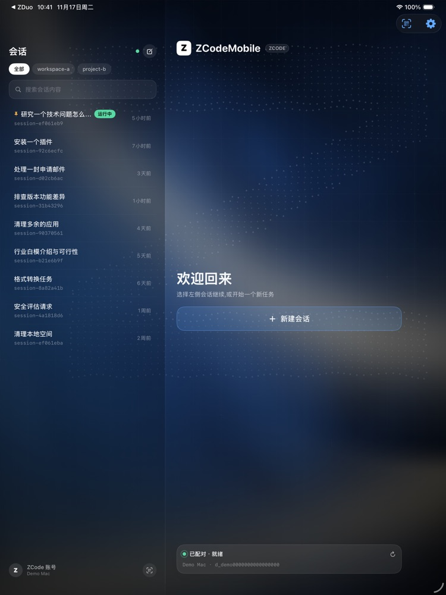
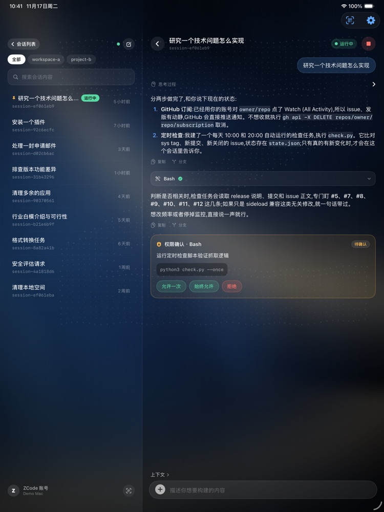

# ZCode Mobile

ZCode 官方中继协议的原生 iPhone 客户端,为 **iPhone Duo** 双屏做了专门适配。

ZCode(智谱 Z.ai / BigModel 的 AI 编程工具)的桌面版自带「移动端远程控制」:桌面端作为 **device** 连到云端中继,手机端作为 **terminal** 扫码配对,即可在手机上查看并操控桌面上的会话。ZCode Mobile 复刻了这套 **V2 中继协议**(无需 Tailscale / 内网穿透,桌面在 NAT 后即可用),并提供了原生的 SwiftUI 界面。

> 非官方项目,与智谱 / Z.ai 无关联。协议为逆向所得,桌面端升级可能导致失效。




## 功能

- 扫码 / 粘贴链接配对桌面端(V2 协议,ZCode ≥ 3.16)
- 应用内官方登录(Z.ai / BigModel),Keychain 持久化,冷启动自动重连
- 会话侧栏:工作区切换、搜索、实时状态、置顶/运行中标记
- 对话流:Markdown 渲染、思考过程折叠、工具调用卡、流式更新
- 发送消息 / 停止执行 / 权限审批与提问应答
- 模型切换(按桌面端真实目录分组)、思考强度(low/high/max)、
  审批模式(完全访问 / 自动审批 / 严格审批 / 默认 / 计划)
- 图片与文件附件(分片上传 + SHA-256 校验,≤20 MiB)
- 用量:上下文占用、缓存命中;Coding Plan 额度与到期时间
- 按会话保留草稿
- 多工作区会话(每个工作区独立 bridge)

### iPhone Duo 适配

- 展开态:左会话栏(37%)+ 右交互区
- Duo 内屏使用系统竖向工具条(`axisBehavior(.verticalPreferred)`)
- 预留区避让(`reservedRegions`),半折叠姿态检测(`onHingeChange`)
- 全局背景:15fps Metal 流体 + 点阵 Z + 光弧,进入会话/键盘弹出自动暂停以省电

## 架构

```
ZCodeMobile/                    SwiftUI App
├── AppModel.swift       编排:登录→配对→连接→交互
├── Features/            Login / Pairing / Sessions / Conversation / Settings / Usage
├── Duo/                 DuoLayout / HingeObserver / 保留区避让
└── Design/              Theme / MarkdownLite / HarnessBackground(Metal 背景)

Packages/ZCodeMobileCore/       协议包(纯 Swift,可独立 swift test)
├── Frame/               CRC32 / IPC 值编码 / rpc-frame 分片与重组
├── Relay/               二维码解析 / JWT 与 REST / 中继 WebSocket 状态机 / SID 接续
└── Channel/             IPC RPC / 逻辑帧重组 / Conversation V4 / Controller / 多工作区桥
```

协议规格文档见 [`docs/specs/`](docs/specs/)(帧编码、中继认证、通道与对话协议)。

## 构建

```bash
# 依赖
brew install xcodegen
# Xcode 27.2+(Duo 相关 API 需要 iOS 27.1 SDK;最低部署 iOS 26)

xcodegen generate
open ZCodeMobile.xcodeproj
```

### 在真机上运行(自行签名)

仓库**不包含任何签名配置**,需要用自己的 Apple ID 签名:

1. Xcode → Settings → Accounts 登录自己的 Apple ID
2. 选中 ZCodeMobile target → Signing & Capabilities → Team 选择你的个人团队
   (免费个人团队即可,iOS 会要求 7 天重签;付费账号可走 TestFlight)
3. 修改 Bundle Identifier 为你自己的唯一值(如 `dev.<you>.zcodemobile`)
4. 连接设备,Cmd+R 运行

### 测试

```bash
cd Packages/ZCodeMobileCore && swift test
```

## 使用

1. 桌面端 ZCode:左下角手机图标 → 打开「移动端远程控制」,出现二维码
2. ZCodeMobile:扫码(或粘贴链接)→ 在 App 内登录**与桌面端相同的账号**
3. 登录完成自动配对,进入会话列表

> 同一台桌面同时只允许一个终端在线,官方网页端与本 App 互踢。

## 已知边界

- 依赖未公开协议,桌面端升级可能破坏兼容
- 用量配额取决于账号类型,部分账号桌面端不返回
- 附件上传尚未在真机全量验证

## License

MIT。第三方代码与协议参考见 [THIRD_PARTY_NOTICES.md](THIRD_PARTY_NOTICES.md)。
